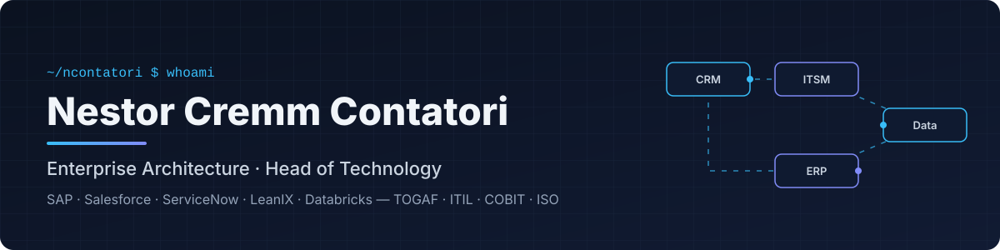
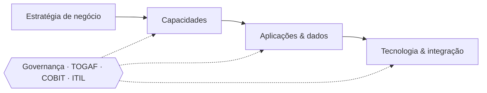

  

  
  
  

## 👋 Olá, eu sou o Nestor

Arquiteto corporativo e líder de tecnologia em **São Paulo**. Conecto estratégia de negócio a plataformas enterprise — desenhando **arquiteturas de referência, integrações e modelos de governança** que fazem SAP, Salesforce, ServiceNow e dados trabalharem como um único ecossistema.

- 🏛️ **Arquitetura Corporativa** — portfólio de aplicações, capacidades de negócio e roadmaps com `TOGAF` e `LeanIX`
- 🔗 **Integração & Soluções** — desenho de integrações entre ERP, CRM, ITSM e plataformas de dados
- 🛡️ **Governança de TI** — `ITIL`, `COBIT` e normas `ISO` aplicados a decisões de arquitetura e operação
- 👥 **Liderança** — coordenação de times de arquitetos sênior
- 🤖 **IA aplicada** — uso de IA no dia a dia de arquitetura e produtividade

> 🇺🇸 *Enterprise Architect & technology leader based in São Paulo, Brazil — bridging business strategy and enterprise platforms (SAP, Salesforce, ServiceNow, Databricks).*

## 🧰 Stack & frameworks

**Plataformas enterprise**

**Arquitetura & governança**

**Ferramentas**

## 🗺️ Como eu penso arquitetura

## 📌 Em destaque

| Projeto | Descrição |
|---|---|
| 🌐 [ncontatori.github.io](https://github.com/ncontatori/ncontatori.github.io) | Meu site pessoal — perfil, atuação e arquitetura em diagramas |
| 📄 [personal-public](https://github.com/ncontatori/personal-public) | Currículo e materiais profissionais públicos |

## 📫 Vamos conversar

Aberto a conversas sobre **arquitetura corporativa, liderança de tecnologia e integração de plataformas**.
O melhor canal é o [LinkedIn](https://linkedin.com/in/nestorcontatori).

Feito com ☕ e Markdown · Itapecerica da Serra, SP

